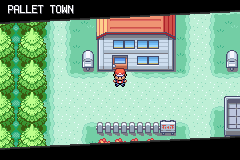

# Code based on BW menu pops for FR.

## Credits to RHH/pokeemerald-expansion, Shiny Miner
- Same build as you build Main-menu-BW, just run command 'make' in powershell.
- If you're new, here are instructions to set up tools: https://github.com/Shiny-Miner/GBA-Binary-hacking-assets/wiki/Tutorial-:-Inserting-Shiny-Miner's-some-of-C-injctions
## FireRed (BPRE) notes
- Only the BW (`OW_POPUP_GENERATION == GEN_5`) pop-up is implemented; the clock option is unavailable (the ROM has no RTC code).
- Graphics live in `graphics/png_to_4bpp` and `graphics/pal_to_gbapal` so the Makefile converts them.
- Hooks for `ShowMapNamePopup`, `DismissMapNamePopup`, `IsMapNamePopupTaskActive` are in `hooks/BPRE/hooks.s` (included from `mainBPRE.asm`).
- `gPopupTaskId` uses free EWRAM at `0x0203FFE0` (see `BPRE.ld`); change it if that byte is used by something else.
- Symbols/addresses are for the `pokefirered.sym` build (BPRE rev0?); BPRS/BPEE `.ld` files and hook addresses were not updated.
